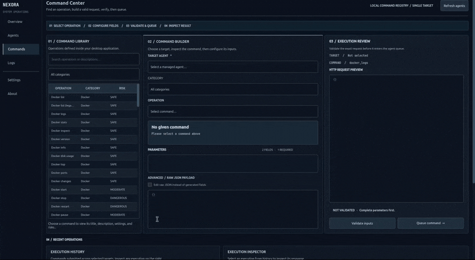
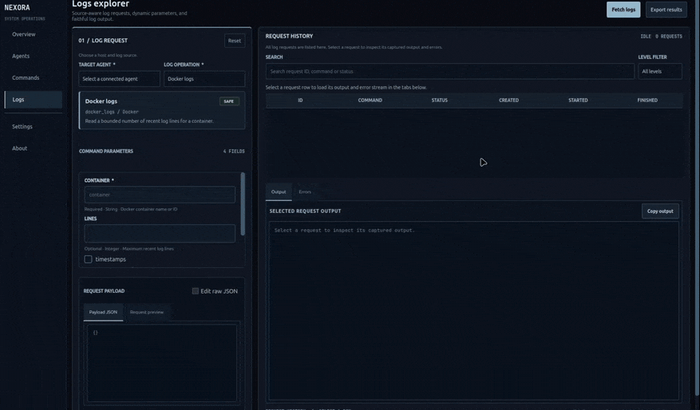
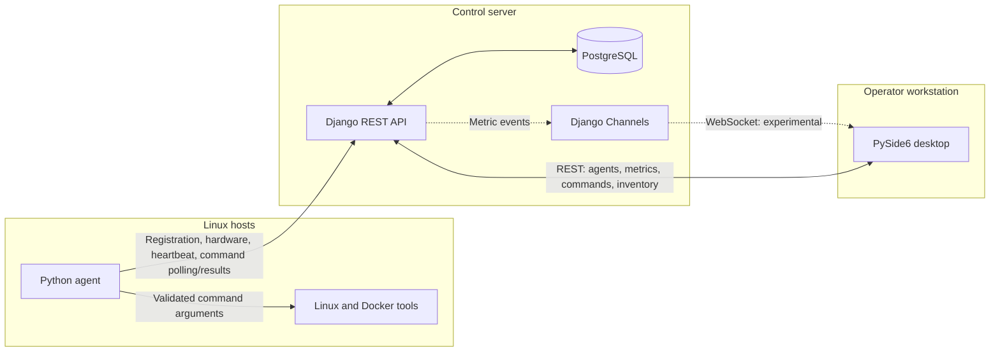

# NexoraControl

[](https://www.python.org/)
[](https://www.djangoproject.com/)
[](https://www.django-rest-framework.org/)
[](https://doc.qt.io/qtforpython-6/)
[](https://www.postgresql.org/)
[](https://docs.docker.com/compose/)
[](LICENSE)

**NexoraControl** is a distributed infrastructure monitoring and remote-management system for Linux hosts. It combines a Django REST API, lightweight Python agents, and a PySide6 desktop console to collect telemetry, inspect hardware, review historical measurements, and dispatch predefined administrative commands.

> [!IMPORTANT]
> **Status: experimental / under active development.** Core monitoring, hardware-inventory, and command-management flows are implemented in the source, but installation, authentication, failure recovery, and deployment still require hardening. **Do not expose this project to the public Internet or use it to administer production infrastructure in its current state.**


## Overview

| Component | Responsibility | Technologies |
| --- | --- | --- |
| **Backend** | Agent registration, REST API, telemetry persistence, hardware inventory, command records and lifecycle | Django, Django REST Framework, PostgreSQL, Django Channels |
| **Host agent** | Registration, hardware discovery, scheduled heartbeats, command polling, validation and execution | Python, `asyncio`, HTTPX, psutil, Linux utilities, Docker CLI |
| **Desktop** | Agent overview, hardware and performance pages, Fleet/Detail command workflows, execution history | PySide6, Qt workers and signals, HTTPX, pyqtgraph |

The full agent feature set currently targets **Linux**. Several inspection and control actions depend on `systemd`, `journalctl`, `iproute2`, or Docker being installed on the monitored host.

## Demonstrations

### Command Builder

Demonstration of agent selection, dynamic command parameters, and command execution.



### Logs Inspector

Demonstration of request history inspection, output and error viewing.



## Features

### Monitoring and historical telemetry

- Agent registration, online/offline state, last-seen timestamps, and host uptime.
- Periodic CPU, memory, swap, storage, network, and thermal measurements (where the host exposes the relevant sensors).
- Per-agent historical measurements retrieved using time-window and resource filters.
- Dashboard, agent listing, detail pages, and time-series graphs in the desktop client.
- Background HTTP operations using Qt workers, signals, pollers, and state stores to avoid blocking the interface.

### Hardware inventory

- Host discovery of CPU specifications, GPUs, memory modules, motherboard/BIOS information, storage devices, and network interfaces.
- Hardware data collection during agent registration, followed by submission to the API.
- A dedicated backend `AgentSystemInfo` model with JSON fields for individual hardware categories.
- A desktop hardware page with separate inventory tables and a refresh action.

Hardware discovery is best-effort: fields depend on the operating system, installed utilities, permissions, and available devices.

### Command execution and management

- **81 predefined commands** described in a registry shared in structure between agent and desktop; **11 populated categories** plus an empty `Custom` category.
- Docker inspection and control, Compose inspection, host information, processes, services, networking, storage, and diagnostics.
- Schema-based payload validation, command-specific checks, per-command timeouts, and explicit confirmation values for selected disruptive operations.
- Command lifecycle persisted as `PENDING → RUNNING → SUCCESS / FAILED`, including payloads, output, structured errors, and timestamps.
- **Detail Commands:** configure and run commands for the currently selected agent, then inspect execution history and results.
- **Fleet Commands:** browse the command catalog, filter by category, select a target agent, and inspect that agent's command history. **Fleet currently means central selection of individual agents, not broadcast execution.**
- Shared `CommandController` logic and `CommandWidgets` bindings, with reusable field construction and specialized Detail/Fleet page controllers.
- Dynamically generated text, numeric, boolean, and choice inputs, with a JSON payload preview.

Commands are constructed as argument lists and executed using `subprocess` without `shell=True`. This reduces shell-parsing risks, but **does not** make the remote-execution feature safe without authorization, least-privilege execution, and operational limits.

### Desktop interface

- A custom dark Qt interface (Steel Console styling) with dashboard, agent, hardware, performance, and command views.
- Common table helpers, reusable widgets, and dedicated API clients for agents, metrics, commands, and hardware data.
- A navigation entry and UI scaffolding for Fleet Logs; **log browsing is not yet a completed feature**.
- Experimental WebSocket client code for live metrics; deployment support remains incomplete (see [Limitations](#current-limitations)).

## Architecture



### Monitoring and hardware data flow

1. The agent registers using the REST API and receives its ID and token.
2. During setup, it collects available hardware metadata and sends it to the agent-specific `system-info` endpoint.
3. Its heartbeat loop periodically sends measurements and uptime; the backend stores metric snapshots and updates agent state.
4. The desktop reads agent metadata, hardware inventory, and historical measurements through API clients running in background workers.
5. Django Channels publishes metric events at the application level. The current Compose stack does **not** provide the ASGI/WebSocket deployment path.

### Command lifecycle

1. The desktop selects a command schema (`command_type`) and prepares a JSON `payload`.
2. The API persists a new command record with `PENDING` status.
3. The agent polls the pending-command endpoint; commands are marked `RUNNING` when retrieved.
4. The agent resolves the command ID in its registry and validates the payload against its schema and any specialized validator.
5. The handler constructs the executable and argument list. The executor runs the process with a timeout and captures the result.
6. The agent reports status, output, errors, and timestamps to the backend. The desktop displays results from stored command history.

> Validation happens **on the agent**, not only in the Qt form. Risk labels and explicit confirmation strings help prevent accidental operations, but they are **not authentication or authorization controls**.

## Command catalog

The current registry contains 81 commands grouped as follows:

| Category | Commands | Examples |
| --- | ---: | --- |
| Docker | 18 | Container list, logs, stats, inspect, start/stop/restart |
| Docker Images | 4 | List, inspect, history, pull |
| Docker Networks | 2 | List, inspect |
| Docker Volumes | 2 | List, inspect |
| Docker Compose | 3 | List services, containers, logs |
| System | 12 | Uptime, OS, CPU/RAM/disk information, kernel, reboot |
| Processes | 4 | Process list, details, threads, tree |
| Services | 9 | Service status, logs, failed units, start/stop/restart |
| Network | 11 | Interfaces, links, routes, sockets, DNS, ping |
| Storage | 7 | Filesystems, block devices, mounts, swap, disk usage |
| Diagnostics | 9 | Journal errors, boot status, failed units, time synchronization |
| Custom | 0 | Reserved for future extensions |
| **Total** | **81** | **11 populated categories** |

For example, a Docker logs command submitted to the command endpoint uses a machine-readable ID rather than the desktop display label:

```json
{
  "command_type": "docker_logs",
  "payload": {
    "container": "nginx",
    "lines": 100,
    "timestamps": true
  }
}
```

The registry defines accepted field types (`string`, `integer`, `float`, `boolean`, and `choice`), required fields, ranges, defaults, patterns, risk metadata, and timeouts. Specialized validators further restrict some Docker filter expressions and `systemd` service targets.

The command catalogs live in `agent/commands/catalog.py` and `desktop/services/commands_map.py`; changes to one should be reflected in the other. The agent's handler registries remain the source for **what the agent can actually execute**.

## Repository structure

```text
NexoraControl/
├── agent/
│   ├── api/                      # Agent HTTP client
│   ├── bootstrap/                # Interactive registration/setup
│   ├── commands/
│   │   ├── catalog.py            # Command schemas and metadata
│   │   ├── docker/               # Container, image, network, volume, Compose handlers
│   │   ├── system/               # System, process, service, network, storage, diagnostics
│   │   ├── validators/           # Shared and specialized payload validation
│   │   ├── parser.py             # Command dispatch and result reporting
│   │   └── executor.py           # Process execution and output collection
│   ├── config/                   # Agent configuration
│   ├── loops/                    # Heartbeat and command polling
│   ├── services/                 # Metrics and hardware collection
│   └── install.sh                # Linux/systemd installer
├── backend/
│   ├── apps/agents/
│   │   ├── api/                  # Serializers, views, authentication, pagination
│   │   ├── models/               # Agents, hardware inventory, metrics, commands
│   │   ├── selectors/            # Database query operations
│   │   ├── services/             # Heartbeat and command state updates
│   │   └── consumer.py           # Experimental Channels consumer
│   └── config/                   # Django settings and ASGI/WSGI
├── desktop/
│   ├── api/client.py             # Agent/command/metric/hardware API clients
│   ├── pages/                   # Dashboard, Detail, Fleet and hardware controllers
│   ├── services/                # Field builder, shared controller, stores, workers
│   ├── styles/theme.qss          # Desktop stylesheet
│   └── ui/                      # Generated Qt UI code
├── conf.d/nginx.conf
├── docker-compose.yml
└── requirements.txt             # Backend dependencies
```

## Technology stack

| Layer | Technologies in the inspected project snapshot |
| --- | --- |
| Backend | Python 3.12+, Django 6.0.7, Django REST Framework 3.18.0, Psycopg 3 |
| Persistence | PostgreSQL 18.4 (Compose image) |
| Live event foundation | Django Channels, currently configured with an in-memory channel layer |
| Host agent | Python, `asyncio`, HTTPX, psutil, Rich, Linux/Docker CLIs |
| Desktop | PySide6, HTTPX, pyqtgraph, NumPy, Qt signals and workers |
| Deployment | Docker Compose, Gunicorn (WSGI), Nginx, `systemd` for agents |

Version badges describe the dependency versions found in the available project snapshot; they are not automatically updated when dependencies change.

## Installation and local development

> **Installation is not yet verified from a clean checkout.** The notes below describe the source's intended setup; see [Current limitations](#current-limitations) before relying on it. Use an isolated development environment.

### 1. Backend

**Prerequisites:** Docker Engine and the Docker Compose plugin.

```bash
git clone https://github.com/kapusta123b/NexoraControl.git
cd NexoraControl
```

Configure the root `.env` for your local deployment (use non-production values only for local testing):

```dotenv
SECRET_KEY=replace-with-a-long-random-secret
DEBUG=False
ALLOWED_HOSTS=localhost,127.0.0.1
CSRF_TRUSTED_ORIGINS=http://localhost
DB_NAME=nexora_control
DB_USER=nexora_control_user
DB_PASS=replace-with-a-strong-password
DB_HOST=db
DB_PORT=5432
```

Check the container configuration and, once dependencies are complete, build the services:

```bash
docker compose config
docker compose up -d --build
docker compose ps
docker compose logs -f api
```

Run migrations, if necessary:

```bash
docker compose exec api python manage.py migrate
```

The REST API is mounted at `/api/v1/`; Django admin uses `/admin/`. Nginx currently listens on HTTP port 80.

**Known dependency issue:** `backend/config/settings.py` and the API views import `daphne` and `django_filters`, but the provided root `requirements.txt` does not declare `daphne` or `django-filter`. Fix the dependency list before expecting a clean backend startup. The project also contains a rewritten Django migration history in the reviewed changes; **do not apply squashed/replaced initial migrations to an existing database without a migration plan and backup**.

### 2. Linux agent

The repository includes an installation script that installs agent files under `/opt/nexora-agent`, creates a Python virtual environment, and configures the `nexora-agent` service under a dedicated system account.

**Review the script before using sudo:**

```bash
curl -fsSL \
  https://raw.githubusercontent.com/kapusta123b/NexoraControl/main/agent/install.sh \
  -o nexora-agent-install.sh
less nexora-agent-install.sh
sudo bash nexora-agent-install.sh
```

The installer requires `git`, `python3`, Python `venv`, `systemd`, and administrative access. During setup, specify the backend API URL ending in `/api/v1/` and a machine name. The agent's default intervals are **5 seconds** for heartbeat submission and **2 seconds** for command polling.

Useful commands after installation:

```bash
sudo systemctl status nexora-agent
sudo journalctl -u nexora-agent -f
sudo systemctl restart nexora-agent
```

The agent dependencies are listed in `agent/requirements.txt`; the entry point is `agent/main.py`. Docker operations additionally require Docker to be installed and the agent process to have appropriate access to the Docker daemon. Registration and service installation have not been independently verified end to end.

### 3. Desktop application

The snapshot does not include a dedicated `desktop/requirements.txt`. To try the desktop locally, install the libraries imported by its current source:

```bash
cd desktop
python3 -m venv .venv
source .venv/bin/activate  # Windows: .venv\Scripts\activate
python -m pip install PySide6 httpx pyqtgraph numpy
python main.py
```

The desktop currently uses a **development-time API URL and placeholder token in `desktop/main.py`**. Update the connection details for your own local environment before testing; user login and credential management are not implemented.

## REST API overview

Paths below are relative to `/api/v1/` and reflect the current Django URL definitions. They should not be treated as a stable or fully secured public API.

| Method | Endpoint | Purpose |
| --- | --- | --- |
| `GET`, `POST` | `/agents/` | List/register agents; listing supports pagination and query filters |
| `GET`, `PUT`, `PATCH`, `DELETE` | `/agents/{id}/` | Read or modify agent details |
| `POST` | `/agents/{id}/heartbeat/` | Receive authenticated telemetry and uptime |
| `GET`, `POST` | `/agents/{id}/system-info/` | Read or submit structured hardware inventory |
| `PUT`, `PATCH`, `DELETE` | `/agents/{id}/system-info/` | Update or remove the inventory record |
| `GET`, `POST` | `/agents/{id}/commands/` | List and create command records |
| `GET` | `/agents/{id}/commands/pending/` | Retrieve pending commands and mark them running |
| `PATCH` | `/agents/{id}/commands/results/` | Submit an array of command results |
| `GET` | `/agents/{id}/metrics/resource/` | CPU and memory history |
| `GET` | `/agents/{id}/metrics/storage/` | Storage history |
| `GET` | `/agents/{id}/metrics/network/` | Network history |
| `GET` | `/agents/{id}/metrics/thermal/` | Thermal history |

Selected query parameters:

- Agent listing: `status`, `hostname`, `search`, `ordering`, `page`, `page_size` (page size defaults to 10, maximum 100).
- Command listing: `status`, `count`, `search`, `ordering` (with pagination configured).
- Metric history: `hours` and type-specific selectors such as `disk`, `disks_names`, `hardware`, `hardware_names`, and `sensors`.
- Hardware inventory: `target_info` can select a hardware category in the serializer's GET response.

The experimental WebSocket route is `ws/monitor/{agent_id}/` relative to the server root, **not** `/api/v1/`. It requires a separately configured ASGI deployment.

## License

Distributed under the [MIT License](LICENSE).
