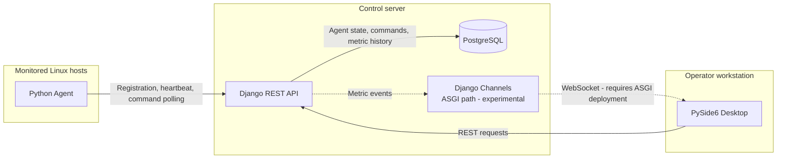

# NexoraControl

[](https://www.python.org/)
[](https://www.djangoproject.com/)
[](https://www.django-rest-framework.org/)
[](https://doc.qt.io/qtforpython-6/)
[](https://www.postgresql.org/)
[](https://docs.docker.com/compose/)
[](LICENSE)

**NexoraControl** is a distributed infrastructure monitoring and remote-control system consisting of a Django REST API, a Python host agent, and a PySide6 desktop application. It is designed to collect host telemetry, retain historical measurements, and provide a central interface for inspecting and managing connected machines.

> [!IMPORTANT]
> **Development status: active development / experimental.** The repository contains working building blocks as well as incomplete integration paths. It is not currently suitable for an untrusted network or production infrastructure. The sections below distinguish implemented components from unfinished functionality.

## Overview

NexoraControl is organized into three independently running components:

| Component | Responsibilities | Core technologies |
| --- | --- | --- |
| **Backend** | Agent registry, REST endpoints, telemetry persistence, command-state models, metrics queries | Django, DRF, PostgreSQL, Channels |
| **Agent** | Host registration workflow, periodic heartbeats, system telemetry, command polling and execution | Python, `asyncio`, HTTPX, psutil, systemd |
| **Desktop** | Agent overview, resource history, hardware information, command activity, and plotting | PySide6, Qt workers/signals, pyqtgraph, HTTPX |

The application currently targets **Linux hosts** for full agent functionality. Several system-information and control commands rely on Linux utilities and systemd.

## Features

### Backend

- REST endpoints for agent registration, listing, details, and heartbeat ingestion.
- Individual agent identifiers and UUID-based bearer tokens for authenticated heartbeats.
- Historical CPU, memory, storage I/O, and thermal telemetry stored in PostgreSQL.
- Time-window queries and optional filters for metrics history.
- Command records with `PENDING`, `RUNNING`, `SUCCESS`, and `FAILED` states, output, errors, and timestamps.
- A service/selector structure separating persistence and query logic from API views.
- Django Channels consumer and event publication for live metric delivery **at the application-code level** (see [Current limitations](#current-limitations)).

### Host agent

- Interactive registration workflow and a Linux `systemd` installation script.
- Configurable heartbeat and command-polling intervals (defaults: **5 seconds** and **2 seconds**).
- CPU utilization, per-core utilization, load averages, RAM and swap usage.
- Block-device statistics, filesystem capacity, and available thermal sensors.
- Registry-driven command handlers with payload validation and execution timeouts.
- Linux system-information commands and selected Docker inspection/control commands.

### Desktop application

- Dashboard and agent overview screens.
- Agent details, historical performance graphs, and hardware/thermal views.
- Background HTTP requests implemented with Qt workers and signals.
- Reusable metric graphs and custom UI widgets.
- An experimental live-metrics WebSocket client.

## Architecture



### Data flow

1. An agent registers with the API and receives an agent ID and UUID token.
2. The agent periodically collects telemetry and submits it to `POST /api/v1/agents/{id}/heartbeat/`.
3. The backend normalizes the payload, stores a metric snapshot, and updates `last_seen` and agent status.
4. The desktop queries registered agents and historical data through REST endpoints.
5. The backend also publishes metric events to a Channels group; consuming those events over WebSocket requires an ASGI server and a compatible reverse-proxy configuration, which are **not yet provided by the current Docker Compose deployment**.

A command lifecycle is modeled as `PENDING → RUNNING → SUCCESS / FAILED`. Agent polling, command handlers, and result-update code are present, but end-to-end command creation is still incomplete; see [Current limitations](#current-limitations).

### Repository layout

```text
NexoraControl/
├── agent/
│   ├── api/                 # Backend HTTP client
│   ├── bootstrap/           # Interactive agent setup
│   ├── commands/            # Registry, validators, executor, system/Docker handlers
│   ├── config/              # Agent configuration
│   ├── loops/               # Heartbeat and command polling
│   ├── services/metrics/    # CPU, memory, storage and thermal collectors
│   └── install.sh           # Linux/systemd installation
├── backend/
│   ├── apps/agents/
│   │   ├── api/             # Authentication, serializers and views
│   │   ├── models/          # Agent, command and metric models
│   │   ├── selectors/       # Database query logic
│   │   ├── services/        # Heartbeat and command operations
│   │   ├── consumer.py      # Channels WebSocket consumer
│   │   └── management/      # Monitoring/recovery experiments
│   └── config/              # Django settings and ASGI/WSGI entry points
├── desktop/
│   ├── api/                 # REST client
│   ├── pages/               # Page controllers
│   ├── services/            # Stores, workers, pollers, graphs and widgets
│   └── ui/                  # Generated Qt UI code
├── conf.d/nginx.conf
├── docker-compose.yml
└── requirements.txt        # Backend dependencies
```

## Technology stack

| Layer | Technology in the inspected source |
| --- | --- |
| Backend | Python 3.12+, Django 6.0.7, Django REST Framework 3.18.0 |
| Database | PostgreSQL 18.4 in Docker Compose; Psycopg 3 |
| Real-time foundation | Django Channels; in-memory channel layer in current settings |
| Agent | Python, HTTPX, psutil, `asyncio`, Rich |
| Desktop | PySide6, Qt WebSockets, HTTPX, pyqtgraph, NumPy |
| Deployment | Docker Compose, Gunicorn (WSGI), Nginx, Linux systemd for the agent |

**Version note:** these values describe the inspected repository snapshot, not a continuously updated list of upstream releases. Django 6.0 requires Python 3.12 or newer; the old Python 3.10+ badge was incorrect for the pinned Django version.

## Installation and development

The following instructions describe the current repository layout. **The setup has not been verified as a clean, end-to-end installation**; review the limitations before deploying or executing remote commands.

### 1. Backend with Docker Compose

Prerequisites: Docker Engine with the Compose plugin, and a host capable of running the provided images.

```bash
git clone https://github.com/kapusta123b/NexoraControl.git
cd NexoraControl
```

Edit the root `.env` file before starting services. Configure at least:

```dotenv
SECRET_KEY=replace-with-a-new-long-random-secret
DEBUG=False
ALLOWED_HOSTS=localhost,127.0.0.1
CSRF_TRUSTED_ORIGINS=http://localhost
DB_NAME=nexora_control
DB_USER=nexora_control_user
DB_PASS=replace-with-a-strong-database-password
DB_HOST=db
DB_PORT=5432
```

Generate a random secret, for example with `openssl rand -hex 32`. Do not reuse example secrets or passwords. Set `ALLOWED_HOSTS`, trusted origins and Nginx `server_name` to match your environment. **The provided reverse proxy listens on HTTP port 80; configure HTTPS before any non-local deployment.**

```bash
docker compose config
docker compose up -d --build
docker compose ps
docker compose logs -f api
```

To apply migrations manually, if required:

```bash
docker compose exec api python manage.py migrate
```

The backend entrypoint also contains migration and static-file collection steps; whether these execute automatically depends on the image entrypoint configuration. The API is mounted under `/api/v1/`, with Django admin under `/admin/`.

> **Deployment caveat:** Compose currently starts `gunicorn config.wsgi:application`, and Nginx does not expose `/ws/`. Consequently, the present container configuration serves HTTP but **does not provide the documented Channels WebSocket route**. For WebSocket deployment, an ASGI server, `/ws/` proxying, and appropriate channel-layer configuration are required. The Django settings also reference `daphne`, which must be installed as a backend dependency when running ASGI development tooling.

### 2. Agent on a Linux host

The repository includes an installer that copies the `agent/` directory to `/opt/nexora-agent`, creates a dedicated service account and Python virtual environment, and configures `nexora-agent.service`.

Inspect the script before running it with elevated privileges:

```bash
curl -fsSL \
  https://raw.githubusercontent.com/kapusta123b/NexoraControl/main/agent/install.sh \
  -o nexora-agent-install.sh
less nexora-agent-install.sh
sudo bash nexora-agent-install.sh
```

The installer expects `git`, `python3`, Python `venv`, and administrative privileges. It asks for an API URL ending in `/api/v1/` and a machine name. The agent must be able to reach that URL from the monitored host.

**Known setup issue:** the initial agent configuration contains an empty token, while `load_settings()` currently rejects empty tokens before registration begins. First-time interactive setup therefore needs a code correction before this installer can be considered reliable.

Once configured, useful service commands are:

```bash
sudo systemctl status nexora-agent
sudo journalctl -u nexora-agent -f
sudo systemctl restart nexora-agent
```

For local development, agent dependencies are listed in `agent/requirements.txt`. The agent entry point is `agent/main.py` (`setup` for registration and `run` by default). Docker-related commands additionally require the Docker CLI and appropriate Docker daemon permissions on the monitored host.

### 3. Desktop client

The inspected snapshot does not contain a separate `desktop/requirements.txt`. Install the packages imported by the current desktop source into a virtual environment:

```bash
cd desktop
python3 -m venv .venv
source .venv/bin/activate  # Windows: .venv\Scripts\activate
python -m pip install PySide6 httpx pyqtgraph numpy
python main.py
```

The desktop client currently contains a **development-only API URL and placeholder token** in `desktop/main.py`. Configure these for your local environment before testing. User sign-in and general desktop credential management are not yet implemented.

## REST API reference

All paths below are relative to `/api/v1/`. They reflect the Django URL configuration and should not be interpreted as a fully validated, publicly secured API contract.

| Method | Endpoint | Purpose |
| --- | --- | --- |
| `GET`, `POST` | `/agents/` | List or register agents |
| `GET`, `PUT`, `PATCH`, `DELETE` | `/agents/{id}/` | Read or modify an agent |
| `POST` | `/agents/{id}/heartbeat/` | Receive and store an authenticated heartbeat |
| `GET`, `POST` | `/agents/{id}/commands/` | List commands; creation endpoint is incomplete |
| `GET` | `/agents/{id}/commands/pending/` | Retrieve pending commands; marks returned commands as running |
| `PATCH` | `/agents/{id}/commands/results/` | Submit command results as a JSON array |
| `GET` | `/agents/{id}/metrics/resource/` | Historical CPU and memory measurements |
| `GET` | `/agents/{id}/metrics/storage/` | Historical storage measurements |
| `GET` | `/agents/{id}/metrics/thermal/` | Historical thermal measurements |

**Supported query parameters in the inspected selectors:**

- `hours`: positive integer time window for historical metrics (default `1`).
- `status`, `count`: filter and limit command listings.
- `disk`, `disks_names`: storage-metric filtering or device-name discovery.
- `hardware`, `hardware_names`, `sensors`: thermal-metric filtering or sensor discovery.

The experimental ASGI route is `ws/monitor/{agent_id}/` (relative to the server root, not `/api/v1/`). It is not available through the current WSGI-only Compose stack.

### Supported agent command types

System commands:

`system_uptime`, `system_os_info`, `system_cpu_info`, `system_ram_info`, `system_disk_info`, `system_processes`, `system_reboot`

Docker commands:

`docker_ps`, `docker_ps_all`, `docker_logs`, `docker_images`, `docker_stats`, `docker_inspect`, `docker_stop_all_containers`, `docker_restart_all_containers`

Commands are dispatched from a registry and passed to `subprocess` as argument lists. Command payloads and results are represented as JSON. Some commands are disruptive; do **not** expose command endpoints on public networks until authorization and execution safeguards are complete.

## Planned development

The following are **planned improvements**, not currently delivered features:

- Role-aware user authentication and permissions (including JWT-based user sessions).
- Agent identity checks and secure enrollment/token management.
- Reliable command dispatch, retries, acknowledgments, and recovery after disconnects.
- An ASGI-based deployment with authenticated live telemetry over WebSockets.
- Redis-backed infrastructure where it provides a measurable benefit; Celery for background jobs.
- Automated tests for API permissions, command transitions, telemetry ingestion, and failure handling.
- Configuration cleanup, reproducible dependency installation, observability, and deployment hardening.

## Security considerations

NexoraControl includes remote administration capabilities. Treat its server and agents as privileged infrastructure components.

- Run only in isolated development or trusted environments until authentication and authorization are complete.
- Never commit real `.env` files, agent tokens, database passwords, or production secrets. Rotate any credentials accidentally committed to version control.
- Prefer TLS for server-to-agent and desktop-to-server communication.
- Restrict agent operating-system permissions and Docker access; Docker daemon access can be highly privileged.
- Avoid exposing the Django admin, agent registration, command endpoints, or unauthenticated WebSockets to the public Internet.

## License

Distributed under the [MIT License](LICENSE).
